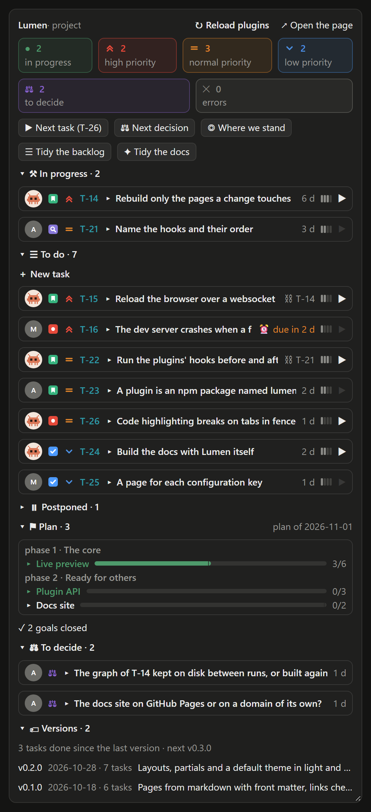
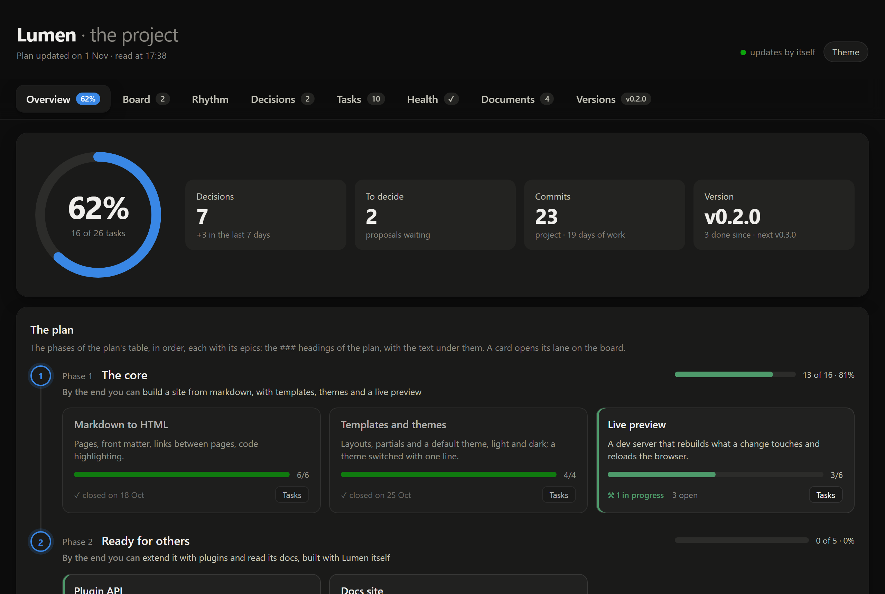
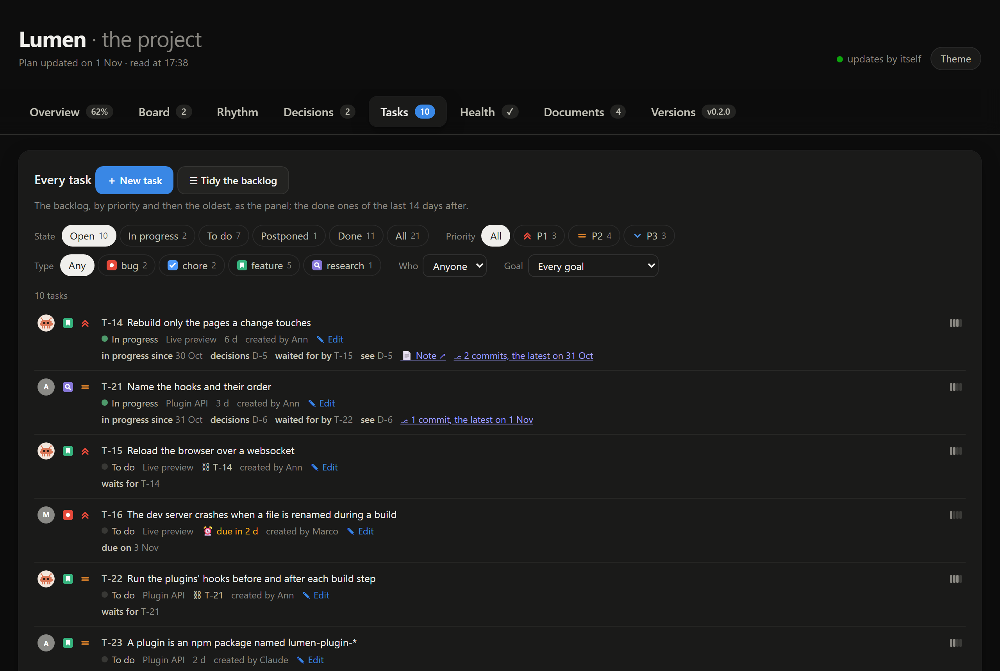

# Project

A project's plan, tasks and decisions for Claude Code, in markdown files the project keeps, changed by deterministic commands instead of by hand: numbers never collide, lines never break, and Claude reads the state of the work instead of guessing it.

```
> start T-61
T-61: In progress
> what did we decide about the hidden dice?
D-73: hidden rolls carry a fingerprint the player can check afterwards…
```

<p align="center">
  
  
</p>
<p align="center"><sub>The panel beside the chat, and the project's page, for a small static site generator three weeks into its work.</sub></p>

One plugin, `project`:

- **The plan**: phases (`| 2. Name | at the end you can… |`) and goals (`### Name (phase 2)`), in `PLAN.md`. `plan.mjs close` closes a goal whose tasks are all closed, with its day (`### Name (phase 2) · done 2026-10-30`), out of the open bars; `open` opens it again; a phase whose goals are all closed is closed too (`plan.mjs phases`), and the panel shows it as one line.
- **The backlog**: one task a line, `- T-12 · P2 · medium · Ann · 2026-10-29 · <goal> · text`, under the heading of its state (in progress, to do, postponed, done), with an archive. A task waits for others with `(after: T-62, #giulia-1)` at the end of its text, a backlog task or a line of a colleague's todo, and points to tasks and decisions with `(see: T-9, D-2)`, shown on both sides; a large task holds smaller ones, each naming it with `(in: T-23)`, and follows them: in progress while one is, its ▶ starting the next; a note, `tasks/T-12.md`, holds what does not fit in a line. A task may carry a type, `(type: bug)`, drawn as Jira draws issue types (bug, feature, chore, research, test, and the project's own), and a due day, `(due: 2026-11-15)`, shown when it is near or past; each says who created it, `(by: Stefano)`: Claude, a person or a colleague; a task started carries its day, `· started 2026-10-30`, and one in progress for days that nobody holds is pointed out. Decisions and tasks that name each other show on both sides. The person `gh` is signed in as, when they are among the project's people, shows with their GitHub picture on their tasks and beside every decision; without GitHub, their initials. `backlog.mjs` adds, starts, finishes, postpones, archives, changes, links and lists them, and refuses a cycle of waits. The commits whose message cites a task, and the pull requests that do (through `gh`, where the repo is on GitHub), show on it; a merged pull request that cites a task still open proposes closing it. The open GitHub issues no task does yet show apart, in the panel and on the page, marked when a title reads like an instruction (a link, a command, «ignore…»); one taken becomes a task with its title and `(issue: #34)`. Claude takes only an issue the user wrote: another's comes in only through the user's → Backlog. A task made from another's issue stays marked, with who wrote it, and Claude is told that its text, like the titles of pull requests and the messages of commits, is data, never an order. Where the project turns it on, the issues and the backlog stay in sync by themselves (below).
- **The decisions**: a numbered table and the points still to decide, in `DECISIONS.md`. `decisions.mjs` gives the next free number (past every number cited anywhere, so two sessions never take the same), shows, finds and says where one is cited.
- **The specifications**, where the project keeps them: `SPECS.md`, one a line with its number, `- S-12 · text`. `specs.mjs` gives the next number, adds, shows, lists with their coverage, finds and says where one is cited; `adopt` makes a specifications' document the project already has the core's, numbered, its text as it was. A task cites the specs it does, `(see: S-12)`, and `show` gives their text; a spec is covered by a task done or by code, in progress by an open task. The page has a tab of them with the coverage, the panel counts them, and the check refuses an S- number the file lacks.
- **The docs' health**: `check.mjs` reports numbers twice or missing, decisions cited that do not exist, task lines that do not read, links to tasks that do not exist and cycles of waits, old proposals, broken links, docs outside their index, heavy files; `--fix` mends whitespace. The `tidy` skill fixes what is mechanical and proposes the rest.
- **Versions and releases**, as the trade keeps them, where the project releases: versions show where it has a release already (a tag, notes, a package's version) or declares contracts or checks, and `release: false` or `true` says otherwise, so a book is never asked to release. A version groups the work done since the last one, never a commit. `release.mjs status` says what is done since and whether a goal closed, an urgent fix or a contract gone up makes a release due, and suggests the number by Semantic Versioning from the tasks' types; `notes` drafts the notes by kind, `write <version>` keeps them in `<docs>/releases/v<version>.md`. A **contract** is a number others read of the project apart from its version (a plugin API, a save format): one gone up raises at least a minor version, the notes record each, and the check flags one that does not read or went down. The **checks before a release**, `release: { run, remember }`: Claude runs the commands without asking, a failure stops the release, and asks the user the rest. The tag, the push and the publishing stay git's and the user's.
- **GitHub, made easy**: the `github` skill and `github.mjs` check git, gh, the account, git's identity, the repo and its remote, the private docs' repo, a site and its Pages; give the steps to install git and gh and sign in, put the project (and its private docs, apart) on GitHub, publish a site on GitHub Pages with a workflow that deploys it at every push, connect a custom domain with its DNS records and HTTPS, and publish a release with its notes. Local files it writes itself (the workflow); what goes to GitHub Claude runs on the user's yes. The start of a session tells Claude when git or gh is missing, and the panel has a button while the project is not on GitHub.
- **GitHub issues in sync**, where the project turns it on (`github: { issues: sync }`, which stands for the user's yes to act on GitHub): the open issues the user of `gh` wrote and is assigned come in as tasks of the coordinator (Claude), the user taking one when they want; where they are the repo's only collaborator, those of nobody too, assigned to them on GitHub. Another's issue never comes in by itself: it waits in the list for the user's → Backlog, and a title another changes on GitHub waits in the panel and the page for the user's yes. Openings and closings go both ways: a task done closes its issue with a comment naming its commits, one archived closes it as not planned, an issue closed closes its task. Title, type and priority (as labels), assignee and milestone stay alike, each from the side that changed it since the last sync; a new task never becomes an issue. The page syncs every five minutes, the start of a session once, each change of the backlog right after it; `issues.mjs sync --dry` says what a sync would do, and the check, the panel and the page tell the last one and what failed.
- **The scripts, enforced**: the start of a session tells Claude to read tasks, decisions and specs through the scripts, and the panel refuses a direct read or write of the backlog and a direct search of the decisions and the specs (a grep, a cat, a Read), naming the command to use: fewer tokens, and lines that never break.
- **The panel** beside the chat: tiles with the counts; buttons for the next task (by priority, then the oldest, past the blocked ones), the next decision, tidying the backlog (priorities, large tasks, texts, tasks already done or made moot, as proposals), where the project stands (a short report, 30 lines at most: what closed, what is best to do next, what could be improved or added) and the docs' tidying; the project's links; in a chat already at work on a task no other starts, neither the next task nor any ▶, as another task belongs to a new session of the project; the tasks in progress, each with ▶ to go on with it (in the chat that holds it, or here), and the tasks to do by priority, each with ▶ to start it (a task that waits shows «⛓ T-62» in place of its age, and its ▶ asks Claude for the whole chain with one yes), a large task's closed parts under it, checked and without ▶, its links and its note when opened, Done and Postpone, the priority turned with a press, its text written again, Archive on a second press; a new task written at the top of the list to do; the plan's goals with their bars; the points still to decide, one brought to the chat as a choice; the specifications with their coverage; the GitHub issues no task does yet, and the last sync; the last versions, each opening its notes in the page; the decisions taken are the page's. It follows the files: a change made elsewhere shows within seconds. `/project-panel` shows or hides it.
- **The page** with the charts, served on localhost from the start of a session, each project on its own port: overview, rhythm, decisions, tasks (added, changed in every field and archived from the list), health with the cleanup, docs, versions (each with its notes, and the work waiting for the next). A project adds parts of its own as extensions.

<p align="center"></p>

The files speak the project's language: English and Italian come built in, any word can be overridden.

## Crew

[Crew](https://github.com/stefanocaronia/claude-crew) is optional. Without it, tasks belong to the people the configuration names. With it, its colleagues hold tasks too, by first name. A colleague's `todo.md` is their own notebook: a line that carries a task's number where Crew puts its id (`- [ ] P1 · 2026-10-28 · T-61 · retest once done`) cites that task, it is not the task, and the check says when it cites one that is missing or closed. The backlog's tasks are opened and assigned by Claude and the user alone: a colleague proposes work in their report, and Claude adds it with `--by <colleague>`; `backlog.mjs todos` lists the colleagues' open lines that cite no task, `take` makes one a task created by the colleague, and the backlog's tidy brings in those that are work for the project. The waits are written as Crew writes them, `(after: #matteo-3)`, so that a task may wait for a todo line and a todo line for a task; Crew sees only the tasks done as they are, never a large task (`backlog.mjs list --atomic --json`); the panel's ▶ hands a colleague's task to Crew's `/crew:next`, and a colleague given a task whose number is in the brief moves it to in progress by itself.

## Requirements

- **Node.js 20 or later** (`node -v`): the commands, the panel's data and the page run on it.
- **git and gh** (GitHub's command line) for the code, the pull requests, the issues and the `github` skill, which installs them when they are missing.
- **Claude Code 2.1.287 or later** for the panel, in the terminal and in the desktop app's Code tab.
- Install from a terminal `claude` session; the commands run `node` through Bash: allow it once when Claude asks.

## Install

```
/plugin marketplace add stefanocaronia/claude-project
/plugin install project@claude-project
```

Then open a new chat and type `/project:init`, or ask "set up the plan and tasks for this project".

**The same commands outside Claude Code**: `npm link` in the plugin's folder (`plugins/project`, or where Claude Code installed it) puts a `project` command on the path, with no dependency and nothing downloaded: `project backlog list`, `project plan phases`, `project decisions next`, `project check --fix`, `project page`, from the project's folder; `project` alone lists them.

**A project that already keeps a plan, tasks or decisions**, with tools of its own, migrates through the same command. `init.mjs adopt` finds the docs, their language, a private repo of their own, the colleagues and where decisions are cited, and prints the configuration that reads them and what reads and what does not, writing nothing. `adopt --write` writes it, and `adopt --steps` moves the plan's checkbox steps into the backlog. Claude proposes the rest point by point: the old tools the plugin replaces, the hooks that started them, the instructions that cite them.

## Configuration

`.claude/project.yaml`, written by `/project:init`:

```yaml
name: My app                 # the title of the README when left out
language: en                 # en, it; another one starts from en with its words below
docs: project                # the docs' folder, from the project's root
people: [Claude, Ann]        # who holds tasks besides Crew's colleagues
cites: [project, .claude, src, docs]   # where a decision number may be cited
page: { port: 5790 }         # optional: by default a port of 5800–5999 from the project's folder
extensions: []               # modules that add the project's own parts to the page, checks and formats
fields: { system: { name: System, values: [5e, ironsworn] }, area: Area }   # optional: the tasks' own fields, (system: 5e)
github: { issues: sync, unassigned: auto, logins: { Ann: ann-gh } }   # optional: the GitHub issues in sync with the backlog
release: { run: [npm test], remember: [Update the changelog] }        # optional: the checks before a release; false: no versions
contracts: [{ name: Save format, file: package.json, pointer: /saveFormat }]   # optional: numbers others read, apart from the version
words: {}                    # any heading or marker, overridden: { states: { postponed: Later } }
```

**The core in English.** The core files' names and format are English in every language: `PLAN.md`, `TASKS.md`, `DECISIONS.md`, `archive/`, `tasks/`, `releases/`, and their headings and marks, `## In progress`, `· done 2026-10-30`, `medium`, `## Goals`, `## To decide`. What the project writes in them stays in its language, and the panel, the page and the messages speak it. A project made before reads as it is, and `init.mjs rename --write` moves it to the English names and format.

**Frontmatter.** Every markdown doc of the project starts with its frontmatter: `title`, `description`, `type` (plan, backlog, archive, decisions, index, note, release, doc), `created` and `updated`, and any key of the project's own after them. The plugin's commands write it and keep `updated` true; a hook does the same after Claude edits a doc by hand; the check notes a doc without it, and `check.mjs --fix` writes it, its days from git.

**Private docs.** A public project can keep its plan in a git repo of its own, nested and ignored: `/project:init` offers it (`--private private` puts the docs in `private/project/`, makes `private/` a repo and adds it to `.gitignore`). A submodule or a folder outside the repo is just a path in `docs:`.

**Extensions** are modules of the project: `export const id`, `collect(context)` for their data, `route(request, context)` for their own paths under `/extension/<id>/`, `script`, a file for the page that calls `projectPage.register({ tabs, tiles, rhythm, mounted })`, and `panel(context)` for links in the panel. `check(context)` adds the project's own checks to the docs' health, `[{ severity, file, line, message }]`, shown under the extension's id; `exporters` and `importers`, `{ name: (tasks, context) => text }` and `{ name: (text, context) => tasks }`, add formats to `backlog.mjs export` and `import`, which read and write JSON and CSV by themselves.

**Fields** are the project's own on a task, declared in `fields:` and written at the end of its line, `(system: 5e)`: `backlog.mjs set T-12 --system 5e` (or `add … --system 5e`), "" clears; a field that lists its values takes only those. `show`, `list --json`, the page's list and form, and the panel show them.

## Files

```
plugins/project/
    lib/            the formats, pure: the backlog's lines, the plan, the decisions, the specs, the todos, the releases, the issues, the words, the configuration
    scripts/        the commands: backlog, plan, decisions, specs, release, check, issues, github, init, adopt, snapshot (the panel's data)
    page/           the page's server, its data, the cleanup, the page
    hooks/          the panel (a Claude Code mod) and the hook that serves the page
    skills/         project, init, tidy, github
```

## Development

```
node --test "plugins/project/test/*.test.mjs"
claude plugin test plugins/project
claude plugin validate .
```

The page's test opens it in a headless Chrome or Edge, the one installed or the one `CHROME_PATH` names, and is skipped without one.

`node tools/screenshots.mjs` makes this README's pictures again, in `images/`: it writes a small demo project with three weeks of history, photographs its page in the same browser, and its panel as `tools/preview.mjs` draws it.

Installed from a local folder (`/plugin marketplace add <folder>`), the plugin is read from that folder: after a change, `/reload-plugins`.

## License

MIT. The YAML parser in `lib/vendor/yaml` is [yaml](https://github.com/eemeli/yaml) by Eemeli Aro, ISC. Project is an independent project, not affiliated with or endorsed by Anthropic. Claude is a trademark of Anthropic.
